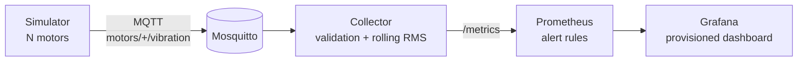

# Industrial IoT Motor Monitoring

[](https://github.com/YaelTriana/iot-motor-monitoring-system/actions/workflows/ci.yml)

A small but complete monitoring pipeline for industrial motors: simulated vibration sensors publish over **MQTT**, a collector turns the stream into **Prometheus** metrics, **Grafana** shows the fleet and Prometheus **alerts** fire when a bearing starts to fail.

One command starts everything:

```bash
docker compose up --build
```

| Service | URL |
|---|---|
| Grafana dashboard | http://localhost:3000 (anonymous view) |
| Prometheus + alerts | http://localhost:9090/alerts |
| Collector metrics | http://localhost:8000/metrics |
| MQTT broker | `localhost:1883`, topic `motors/<id>/vibration` |

---

## Architecture



- **Simulator** (`src/motormon/simulator.py`): each motor has its own baseline, noise and a rotation harmonic. At random a fault starts and vibration climbs a little every tick, like real bearing wear.
- **Collector** (`src/motormon/collector.py`): subscribes to every motor, rejects malformed messages (and counts them), keeps a rolling RMS per motor and classifies it as OK, warning or critical.
- **Prometheus** scrapes the collector every 5 s and evaluates the rules in `docker/prometheus/alerts.yml`.
- **Grafana** is provisioned from code: data source and dashboard live in `docker/grafana/`.

### Metrics

| Metric | Type | Meaning |
|---|---|---|
| `motor_vibration_g{motor_id}` | gauge | Last reading |
| `motor_vibration_rms_g{motor_id}` | gauge | Rolling RMS over the last 10 readings |
| `motor_status{motor_id}` | gauge | 0 OK · 1 warning · 2 critical |
| `motor_last_message_timestamp_seconds{motor_id}` | gauge | When the motor last reported |
| `mqtt_messages_total` / `mqtt_invalid_messages_total` | counter | Accepted and rejected messages |

### Alerts

| Alert | Fires when |
|---|---|
| `MotorVibrationWarning` | RMS ≥ 1.2 g for 30 s |
| `MotorVibrationCritical` | RMS ≥ 1.8 g for 15 s |
| `MotorSilent` | A motor sends nothing for 30 s |
| `CollectorDown` | Prometheus cannot scrape the collector |

The thresholds are design assumptions for this simulation, not values taken from a standard.

---

## Configuration

All settings are environment variables, so the same code runs in Docker and locally.

| Variable | Default | Used by |
|---|---|---|
| `MOTORS` | `3` | simulator |
| `INTERVAL` | `1` (seconds) | simulator |
| `FAULT_PROBABILITY` | `0.002` per tick | simulator |
| `SEED` | random | simulator |
| `MQTT_HOST` / `MQTT_PORT` | `localhost` / `1883` | both |
| `METRICS_PORT` | `8000` | collector |

Example: `MOTORS=8 FAULT_PROBABILITY=0.01 docker compose up --build`

## Running without Docker

```bash
pip install -e ".[dev]"
motormon-collector            # needs an MQTT broker on localhost:1883
MOTORS=5 motormon-simulator
```

## Tests

```bash
pytest -q          # model, payload validation, rolling RMS, status and metrics
ruff check .
```

CI runs the tests, validates the compose file and the Prometheus rules, and smoke-tests the pipeline end to end with Docker.

## Project structure

```
src/motormon/
  model.py          vibration model and fault injection
  simulator.py      MQTT publisher
  collector.py      MQTT -> Prometheus
tests/
docker/
  mosquitto/        broker config
  prometheus/       scrape config + alert rules
  grafana/          provisioned data source + dashboard
docker-compose.yml
Dockerfile
```

## Next steps

- Persist readings (TimescaleDB or InfluxDB) for longer-term analysis
- Alertmanager routing to email or Telegram
- Replace the simulator with a real sensor (ESP32 + accelerometer)

---

Yael Kristoph Triana Sánchez · Computer Systems Engineering, TecNM Tijuana
